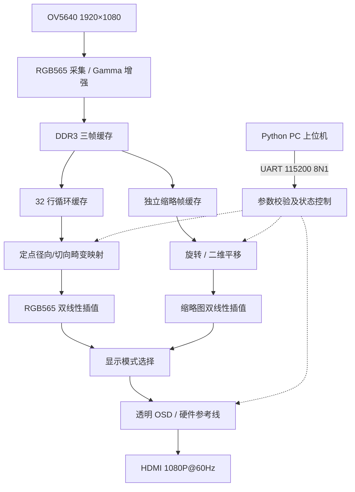

# 基于 PGL50H FPGA 的实时图像畸变矫正与动态仿射变换系统

> 全国大学生嵌入式芯片与系统设计竞赛 · 紫光同创 FPGA 赛道相关作品  
> **PGL50H · OV5640 · DDR3 · RGB565 · HDMI 1080P@60Hz · Python 上位机**


本项目面向机器视觉中镜头畸变、姿态变化及复杂光照等问题，基于**紫光同创 PGL50H FPGA**构建完整的硬件视频处理通路：OV5640 图像采集、DDR3 三帧缓存、定点几何映射、双线性插值、动态仿射变换、图像增强与 HDMI 输出。PC 仅负责通过 UART 下发控制命令及参数，**不参与任何图像像素的实时运算**。

主处理通路针对 **1920×1080** 图像设计，HDMI 采用 **1920×1080@60Hz** 显示时序；**60Hz 是输出刷新率，不代表摄像头以 60fps 采集不同画面**。

## 1. 系统架构



*示意图仅表示主要数据通路与控制关系。具体 Gamma 位置、缓存调度、寄存级数和跨时钟域细节以实际 RTL 为准。*

## 2. 功能概览与设计亮点

| 模块 | 已实现功能 | 技术特点 |
| --- | --- | --- |
| **实时几何矫正** | 径向 `K1/K2`、切向 `P1/P2` 畸变模型 | 32 行循环缓存、定点坐标流水线、双线性插值 |
| **四参数动态加载** | Q16.16 参数通过 UART 在线下发 | 校验、参数范围及组合预算检查、帧边界提交、**硬件越界防爆保护** |
| **仿射变换** | **0°～359° 整数角度**旋转与二维平移 | 独立缩略帧支路，绕开大角度旋转的跨行缓存限制 |
| **图像增强** | 自适应 Gamma | 可通过串口切换，支持明暗场景演示 |
| **状态与辅助显示** | 透明 OSD、十字线、边框、100 像素参考网格 | FPGA 纯 LUT 内部生成，便于状态查看及视觉对比 |
| **PC 控制** | Python 图形化上位机 | COM 扫描、12 字节配置包、24 字节系数包、一键操作 |

主显示处理流水线延迟为 **32 个像素时钟周期**，不包括摄像头采集与 DDR3 帧缓存造成的端到端延迟。任意角度旋转功能由**缩略帧支路**实现，不代表 1920×1080 全分辨率无损旋转。

## 3. 硬件与开发环境

| 项目 | 配置 |
| --- | --- |
| FPGA | 紫光同创 PGL50H（工程目标器件以 `.pds` 为准） |
| 开发工具 | **Pango Design Suite 2025.2** |
| 输入 | OV5640，1920×1080，RGB565 |
| 缓存 | DDR3 三帧缓存 + 32 行循环缓存；缩略旋转使用独立帧存储 |
| 输出 | HDMI 1920×1080@60Hz，像素时钟 148.5MHz |
| 串口 | CP2102 USB-UART，115200，8N1 |
| PC 端 | Windows、Python 3.9+、Tkinter、PySerial |
| 第三方 IP | **官方 DDR3 IP** 等依赖，已适配更新后的 PDS 2025.2 工程 |

**第三方 IP 与分发说明：** 重建工程前需安装适配 PGL50H 和 PDS 2025.2 的官方 DDR3 IP。厂商加密文件、IP 生成文件以及其他依赖的使用与再分发受各自授权条件约束。详细说明见 [`docs/THIRD_PARTY.md`](docs/THIRD_PARTY.md)。

## 4. 仓库目录

```text
FPGA_distortion/
├── Fpga_Project/
│   ├── source/                          # RTL、可分发的工程依赖及相关 IP 配置
│   ├── HDMI_DDR3_OV5640_test.pds         # PDS 2025.2 工程文件
│   ├── hdmi_ddr_ov5640_top.fdc          # 引脚/时序约束
│   └── impl.tcl                         # 工程实现脚本（如使用）
├── OV5640_PC_Controller/
│   ├── app.py                           # 图形界面
│   ├── protocol.py                      # 协议编码、校验与参数检查
│   ├── test_protocol.py                 # 协议测试
│   ├── requirements.txt
│   ├── run_windows.bat
│   └── README.md
├── docs/
│   ├── gui_preview.png
│   ├── resource_utilization.png
│   ├── hdmi_ddr_ov5640_top.rtr          # 最终时序报告
│   └── THIRD_PARTY.md
└── README.md
```

> **注意：** 实际仓库以已上传文件为准。请勿上传不必要的综合数据库、布局布线缓存及工具日志，也不要混用旧版与新版 DDR3 IP。

### 核心 RTL 模块索引

| 模块文件 | 功能 |
| --- | --- |
| `hdmi_ddr_ov5640_top.v` | 顶层连接、模式选择及输出协调 |
| `reg_config.v` | OV5640 寄存器配置 |
| `fram_buf.v` | 32 行循环缓存及像素访问 |
| `distortion_dynamic_q16.v` | 四系数定点畸变坐标映射 |
| `bilinear_interp_rgb565.v` | RGB565 双线性插值 |
| `thumb_frame_store.v` | 缩略帧数据存储 |
| `thumb_rotate_map.v`、`thumbnail_rotation.v` | 缩略图旋转坐标及输出支路 |
| `adaptive_gamma_rgb565.v` | 自适应 Gamma 处理 |
| `video_cmd_ctrl.v` | UART 指令解析与参数提交 |
| `video_status_osd.v` | 透明 OSD 和模型参数显示 |
| `video_reference_overlay.v` | 参考线/边框/网格叠加 |

## 5. 快速开始：FPGA 工程

1. 安装 **PDS 2025.2**，并按官方授权流程安装与器件匹配的 DDR3 IP。
2. 打开 `Fpga_Project/HDMI_DDR3_OV5640_test.pds`。
3. 检查 `source/`、DDR3 IP 的引用路径、顶层模块及 `.fdc` 约束；目录移动后尤其要排查**绝对路径**。
4. 在 PDS 中依次执行 **Synthesize → Place and Route → Report Timing → Generate Bitstream**。
5. 检查所有关键时钟的时序约束，随后在硬件条件允许时下载比特流并验证 OV5640、DDR3、HDMI 和 UART。

## 6. 快速开始：Python 上位机


进入 `OV5640_PC_Controller/`，在 Windows 中双击 `run_windows.bat`；也可以执行：

```powershell
cd OV5640_PC_Controller
python -m pip install -r requirements.txt
python app.py
```

常用单字节 HEX 指令：`01` 切换畸变、`04` 恢复全屏、`05` 切换 Gamma、`06` 参考线开关、`07` 切换参考线模式、`08` 切换 OSD。字段定义、校验范围与示例报文见 [`OV5640_PC_Controller/README.md`](OV5640_PC_Controller/README.md)。

**当前协议无板端确认帧**：PC“发送成功”只表示串口写入完成，不能等同于 FPGA 已接受或执行，应结合 HDMI/OSD 画面核验。

## 7. 默认模型参数与精度边界

当前工程采用的默认 Q16.16 整数系数如下：

| 系数 | Q16.16 整数 | 实际数值（近似） |
| --- | ---: | ---: |
| K1 | **655** | +0.009995 |
| K2 | **16** | +0.000244 |
| P1 | **8** | +0.000122 |
| P2 | **8** | +0.000122 |

该组系数用于**工程模型与动态加载功能演示**。其中 K1 为基于棋盘格图像拟合的工程近似值；K2/P1/P2 保留了极小的非零残差，用于验证底层四参数硬件流水线的功能完整性。OSD 的 `MODEL CORNER SHIFT` 等属于模型预测的几何映射量；显示 `< 0.1 PX` 时也不能将其视为已经验证的实测残余误差。

## 8. 性能、资源与验证状态

### PDS 2025.2 时序分析

官方 DDR3 IP 更新后，PDS 已完成综合、布局布线、时序分析并生成比特流；截图中的实现报告显示 **All Constraints Met**，Setup（Slow）最差裕量约 **+0.764 ns**。

### 资源利用率

下图为 PDS 2025.2 的 **Device Map → Resource Usage Summary**：


| FPGA 资源 | 使用量 / 总量 | 利用率 |
| --- | ---: | ---: |
| APM（DSP） | 45 / 84 | **54%** |
| DRM（块 RAM） | 117.5 / 134 | **88%** |
| LUT | 12,334 / 42,800 | **29%** |
| FF | 13,723 / 64,200 | **22%** |

DRM 占用相对较高，是本工程为了 1080P 三帧缓存及 32 行流式处理付出的合理物理代价。

### 功能验证范围

- **功能验证：** 已验证 OV5640 → DDR3 → HDMI 图像显示、动态畸变开关、旋转和平移、自适应 Gamma、OSD/参考线及 UART 控制等。

## 9. 已知事项与设计限制

- **行缓存限制：** 正常畸变矫正依赖 32 行循环缓存，不适合直接承担大角度旋转所需的跨行随机读取 (K1max < 0.05，否则会导致缓存击穿)。
- **旋转分辨率：** 0°～359° 整数角度旋转在缩略帧路径下实现。
- **输出与采集帧率：** HDMI 1080P@60Hz 与 OV5640 实际采集 FPS 是两项不同指标。
- **参数来源：** K1 为基于棋盘格图像拟合的工程近似值；K2/P1/P2 保留了极小的非零残差，用于验证底层四参数硬件流水线的功能完整性，并非高精度测定的物理畸变常数。
- **精度指标：** 角点模型位移及理想误差文字不等同于现场实测校正精度。
- **厂商依赖：** DDR3 等 IP 的可再分发范围以授权协议为准；仅上传 `.pds` 文件未必足以复现完整工程。

## 10. 使用与授权说明

本仓库内容用于全国大学生嵌入式芯片与系统设计竞赛评审及相关技术交流。**未经作者书面许可，不得将作者自有代码用于商业用途，也不得擅自复制冒充原创作品。** 本说明不替代适用法律或第三方授权条款。

**当前未在本 README 中声明采用某一开放源代码许可证。** 任何第三方 FPGA IP、加密 RTL、工具文件和库仍受各自权利人许可约束，详见 [`docs/THIRD_PARTY.md`](docs/THIRD_PARTY.md)。
