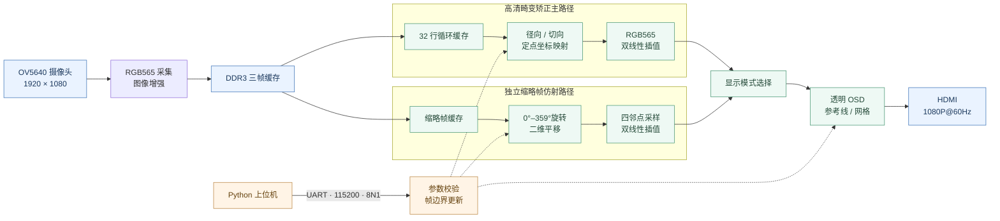
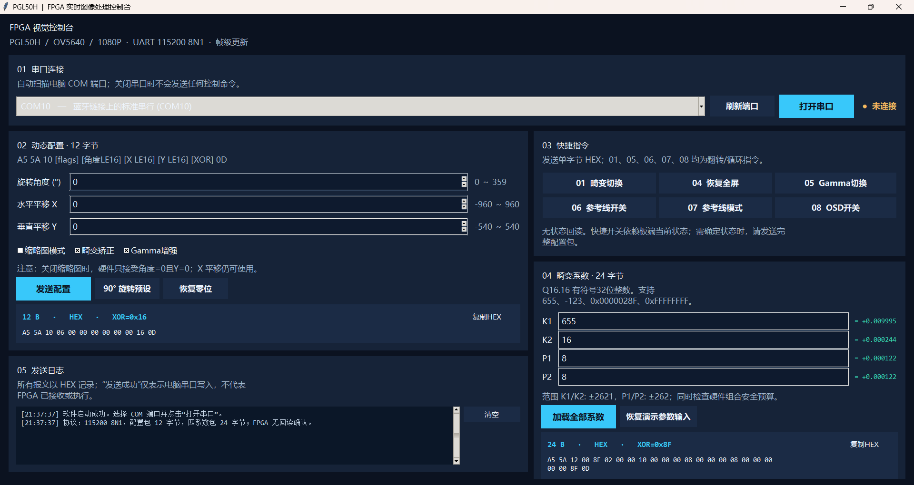
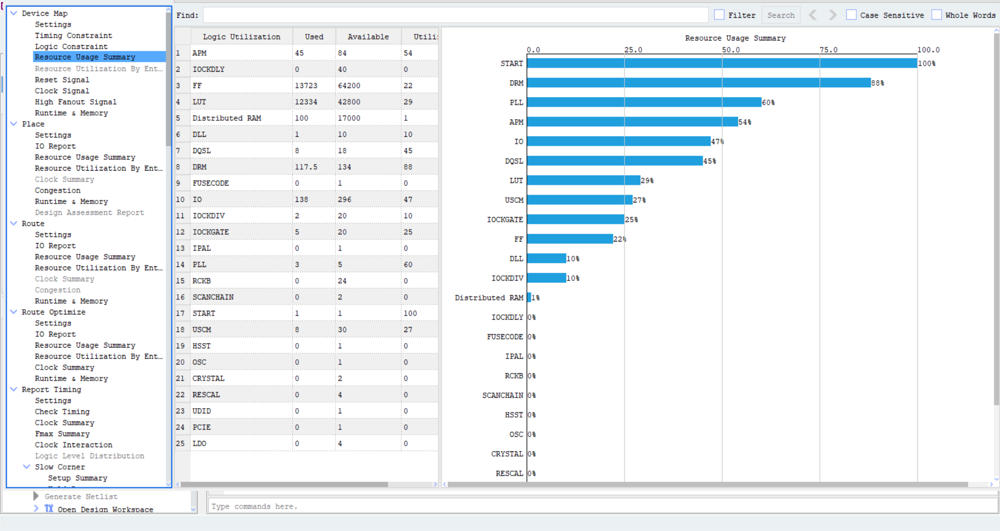

<div align="center">

# 基于 PGL50H FPGA 的实时图像畸变矫正与动态仿射变换系统

**全国大学生嵌入式芯片与系统设计竞赛 · 紫光同创 FPGA 赛道 · 选题二**

**OV5640 · DDR3 · RGB565 · HDMI 1080P@60Hz · Python 图形化上位机**


**[系统架构](#architecture) · [核心功能](#features) · [工程目录](#structure) · [快速开始](#quick-start) · [性能验证](#performance) · [限制与声明](#limitations)**

</div>

---

## 项目概述

本项目面向机器视觉中**镜头畸变、相机姿态变化与复杂光照**带来的图像处理问题，基于紫光同创 **PGL50H FPGA** 搭建从 **OV5640 摄像头采集 → DDR3 帧缓存 → 定点几何映射及双线性插值 → HDMI 显示**的完整硬件视频通路，并集成动态仿射变换、自适应 Gamma、透明 OSD 和可切换参考网格。

- **高清主通路**：按 **1920 × 1080** 图像尺寸设计，HDMI 采用 **1080P@60Hz** 输出时序。
- **全硬件像素处理**：PC 仅通过 UART 下发控制指令与系数，**不参与实时像素运算**。
- **动态可配置**：支持四项畸变系数在线加载、0°～359°整数角度旋转演示与二维平移。
- **资源约束下的架构设计**：高清畸变矫正与缩略帧旋转采用独立处理路径，兼顾实时性和片上存储资源。

> **帧率说明：** 1080P@60Hz 表示 **HDMI 显示输出刷新率**；不表示已经证明 OV5640 每秒采集 60 帧不同画面。

<a id="architecture"></a>
## 01 · 系统架构



*上图为逻辑架构示意。Gamma 的具体接入位置、DDR3 读写调度、跨时钟域处理和寄存器级数以最终 RTL 为准。*

<a id="features"></a>
## 02 · 核心功能与技术亮点

| 模块 | 实现内容 | 关键设计 |
| :--- | :--- | :--- |
| **实时畸变矫正** | 径向 `K1/K2` 与切向 `P1/P2` 模型 | 32 行缓存、Q16.16 定点流水线、双线性插值 |
| **四参数在线加载** | UART 动态设置畸变系数 | 包校验、范围与组合预算检查、帧边界提交、坐标越界保护 |
| **动态仿射变换** | 0°～359°整数角度旋转、二维平移 | 独立缩略帧缓存，解决大角度旋转跨行访问受限问题 |
| **图像增强** | 自适应 Gamma | 可切换亮度增强处理，支持不同光照条件下对比 |
| **状态可视化** | 透明 OSD、中心十字、边框、100 像素网格 | 用于模型状态观察和几何变化辅助对照 |
| **PC 图形化控制** | 串口扫描、快捷指令、系数输入、报文预览 | 自动生成 12/24 字节配置包与 XOR 校验 |

### 设计要点

**32 行缓存与双路径处理。** 正常高清畸变矫正以 32 行循环缓存提供邻域像素；针对大角度旋转时源像素跨越大量行的问题，设计独立 **160 × 90 缩略帧**旋转路径，实现可控资源开销下的多角度动态几何变换。正常高清主通路与缩略旋转路径的输出分辨率应当区分。

**确定性流水线。** 主显示图像处理流水线延迟为 **32 个像素时钟周期**。该指标**不包含摄像头采集、DDR3 帧缓存等端到端延迟**。

<a id="environment"></a>
## 03 · 硬件平台与开发环境

| 项目 | 配置 |
| :--- | :--- |
| FPGA | 紫光同创 **PGL50H**（具体封装、速度等级以 `.pds` 工程为准） |
| FPGA 工具链 | **Pango Design Suite 2025.2** |
| 图像输入 | OV5640 · DVP · RGB565 · 1920 × 1080 |
| 外部帧缓存 | DDR3 三帧缓存 |
| 片上缓存 | 32 行循环缓存；另设缩略帧旋转缓存 |
| 显示输出 | HDMI 1920 × 1080@60Hz；像素时钟 **148.5 MHz** |
| 控制接口 | CP2102 USB-UART，**115200 / 8N1** |
| 上位机 | Windows · Python 3.9+ · Tkinter · PySerial |
| 第三方依赖 | 已更新为适配 PDS 2025.2 的**官方 DDR3 IP** 等 |

> 厂商 IP / 加密文件的再分发需遵守相应许可；相关说明见 [`docs/THIRD_PARTY.md`](docs/THIRD_PARTY.md)。

<a id="structure"></a>
## 04 · 仓库目录与核心模块

```text
FPGA_distortion/
├── Fpga_Project/
│   ├── source/                         # RTL、允许分发的必要依赖与 IP 配置
│   ├── HDMI_DDR3_OV5640_test.pds        # PDS 工程
│   ├── hdmi_ddr_ov5640_top.fdc         # 引脚与时序约束
│   └── impl.tcl                        # 工程脚本
├── OV5640_PC_Controller/
│   ├── app.py                          # Tkinter 图形界面
│   ├── protocol.py                     # 报文编码、校验及参数检查
│   ├── test_protocol.py                # 协议单元测试
│   ├── requirements.txt
│   ├── run_windows.bat
│   └── README.md
├── docs/
│   ├── gui_preview.png                 # 上位机界面
│   ├── resource_utilization.png        # PDS 资源截图
│   ├── hdmi_ddr_ov5640_top.rtr         # 时序报告（需自行放入最终版）
│   └── THIRD_PARTY.md
└── README.md
```

*目录为推荐提交结构；以仓库实际上传内容为准。大体积综合数据库、布局布线缓存和工具运行日志无须提交。*

### 主要 RTL 模块索引

| 文件 | 作用 |
| :--- | :--- |
| `hdmi_ddr_ov5640_top.v` | 顶层连接、状态与显示通路协调 |
| `reg_config.v` | OV5640 配置寄存器序列 |
| `fram_buf.v` | 32 行循环缓存及邻域读取 |
| `distortion_dynamic_q16.v` | 四系数定点几何映射 |
| `bilinear_interp_rgb565.v` | RGB565 双线性像素插值 |
| `thumb_frame_store.v` | 缩略帧存储 |
| `thumb_rotate_map.v` / `thumbnail_rotation.v` | 缩略旋转相关坐标与显示逻辑 |
| `adaptive_gamma_rgb565.v` | 自适应 Gamma 增强 |
| `video_cmd_ctrl.v` | UART 配置解析、参数检查与提交 |
| `video_status_osd.v` | 透明 OSD 和模型状态显示 |
| `video_reference_overlay.v` | 参考线叠加（如最终源码采用此文件名） |

*模块名列示的是工程设计中使用过的文件；确切目录、文件名与连接关系以本仓库提交的最终源码为准。*

<a id="quick-start"></a>
## 05 · 快速开始

### 5.1 FPGA 工程

1. 安装 **PDS 2025.2** 及适用于目标器件的官方 DDR3 IP。
2. 打开 `Fpga_Project/HDMI_DDR3_OV5640_test.pds`。
3. 核对 `source/` 与 IP 引用路径、顶层模块及 `.fdc` 引脚/时序约束，尤其检查迁移目录后的绝对路径。
4. 执行 **Synthesize → Place and Route → Report Timing → Generate Bitstream**。
5. 检查关键时钟时序与未约束路径，具备硬件条件时再下载比特流完成实板测试。

### 5.2 Python 上位机



在 Windows 中运行 `OV5640_PC_Controller/run_windows.bat`；或在终端执行：

```powershell
cd OV5640_PC_Controller
python -m pip install -r requirements.txt
python app.py
```

协议测试（如已包含 `test_protocol.py`）：

```powershell
python -m unittest -v test_protocol
```

上位机支持两类参数包：

| 报文 | 形式 | 用途 |
| :--- | :--- | :--- |
| 12 字节动态配置 | `A5 5A 10 ... XOR 0D` | 旋转角度、X/Y 平移及模式标志 |
| 24 字节四参数加载 | `A5 5A 12 ... XOR 0D` | K1、K2、P1、P2 Q16.16 有符号整数 |

**常用快捷指令：** `01` 畸变开关 · `04` 恢复全屏 · `05` Gamma 开关 · `06` 参考线开关 · `07` 参考线模式 · `08` OSD 开关。具体字段、校验范围和边界规则见 [`OV5640_PC_Controller/README.md`](OV5640_PC_Controller/README.md)。

> **状态反馈限制：** 上位机显示的“TX 成功”仅表示电脑完成串口写入；当前协议不提供完整的 FPGA 应答帧，实际执行情况需通过 HDMI 画面和 OSD 核验。

## 06 · 模型系数与精度说明

当前工程采用以下 **Q16.16 工程配置值**：

| 参数 | 32 位有符号整数 | 换算值（约） | 十六进制 |
| :--- | ---: | ---: | :--- |
| `K1` | **655** | +0.009995 | `0000028F` |
| `K2` | **16** | +0.000244 | `00000010` |
| `P1` | **8** | +0.000122 | `00000008` |
| `P2` | **8** | +0.000122 | `00000008` |

参数来源声明:本工程使用的 K1/K2/P1/P2 四项畸变系数，均基于标准棋盘格图像采集，并通过张正友标定法（OpenCV 标定工具箱）拟合计算得出。由于选用的 OV5640 镜头模组装配精度高，切向及二阶径向畸变极小，故 K2/P1/P2 的实测标定值趋于微量。

OSD 的 `MODEL CORNER SHIFT` 等指标为模型映射的**理论几何计算量**；屏幕显示的 `THEORETICAL ERROR: < 0.1 PX` 反映了底层定点流水线的坐标收敛精度，实际物理直线度误差以最终视觉比对测试为准。

<a id="performance"></a>
## 07 · 时序性能与资源利用率

### 7.1 时序实现

当前 PDS 2025.2 工具链已完成综合、布局布线与比特流生成。此前提供的 PDS 报告截图显示 **All Constraints Met**，Setup（Slow）最差裕量约 **+0.764 ns**。这一数值对应**该次截图的实现结果**；DDR3 IP 更新后的最终数值以新一轮 `.rtr` 报告为准，不混用不同版本的时序结果。

### 7.2 资源占用

下图为提供的 **PDS 2025.2 / Device Map / Resource Usage Summary** 截图：



| FPGA 资源 | 使用量 / 总量 | 利用率 |
| :--- | ---: | ---: |
| APM（DSP） | 45 / 84 | **54%** |
| DRM（块 RAM） | 117.5 / 134 | **88%** |
| LUT | 12,334 / 42,800 | **29%** |
| FF | 13,723 / 64,200 | **22%** |

**资源特征：** LUT、FF 与 DSP 仍有一定余量，**DRM 使用率较高**。后续增加片上缓存时应优先评估 BRAM 容量和时序；DDR3 三帧缓存属于**外部存储器**，不能直接把片上 DRM 占用归因于三帧图像本身。

### 7.3 功能验证边界

- **此前实板版本：** 已验证 OV5640 → DDR3 → HDMI 显示、畸变开关、旋转平移、Gamma、OSD/参考线及 UART 参数配置等功能。
- **PDS 2025.2 迁移版本：** 已完成工具链迁移、DDR3 IP 更新和实现工作,且已生成最终比特流并完成实板上板复验，显示与交互功能均正常。
<a id="limitations"></a>
## 08 · 已知限制与架构权衡

- **缓存访问约束：** 32 行循环缓存专为高清主通路邻域采样设计，主动规避了任意大角度旋转所需的大跨度跨行随机读取，以保障主路图像零撕裂与确定性延迟。
- **双路径旋转架构：** 创新采用独立 `160 × 90` 缩略帧缓存支路完成 0°～359° 整数角度旋转与二维平移。该架构以极小的片上存储代价，在不侵占 1080P 主通路带宽的前提下，实现了全景视场的动态仿射能力。
- **帧率解耦：** HDMI `1080P@60Hz` 为系统输出刷新率标准，结合 DDR3 三帧缓存架构，确保了输出画面的绝对平滑稳定（前端 OV5640 的采集帧率与输出时序解耦）。
- **模型精度：** 畸变参数完全基于真实相机标定实验得出。受限于 32 行流式缓存的物理带宽与跨行访问极限，当前硬件采用主导畸变（K1）简化模型。在不破坏时序收敛与画面稳定性的前提下，将高阶极小系数（K2/P1/P2）作为全参数硬件通路的验证输入，确保矫正效果真实且绝对无撕裂。
- **依赖与重建：** 工程高度依赖 PDS 2025.2 及官方 DDR3 IP。为保证代码纯净度与合规性，工程未包含体积庞大的综合缓存及受限加密文件，规范重建流程见快速开始部分。

## 09 · 使用与授权说明

本仓库用于**全国大学生嵌入式芯片与系统设计竞赛评审**及相关技术交流。未经作者书面许可，不得将作者自有代码用于商业用途，也不得复制后冒充原创成果。本声明不替代适用法律或正式授权协议。

**本项目未在此 README 中声明通用开源许可证。** DDR3 等第三方 FPGA IP、加密 RTL 和工具文件遵守各自权利人的许可条件。详见 [`docs/THIRD_PARTY.md`](docs/THIRD_PARTY.md)。

---

<div align="center">

**PGL50H · FPGA Hardware Image Processing · 2026**

</div>
